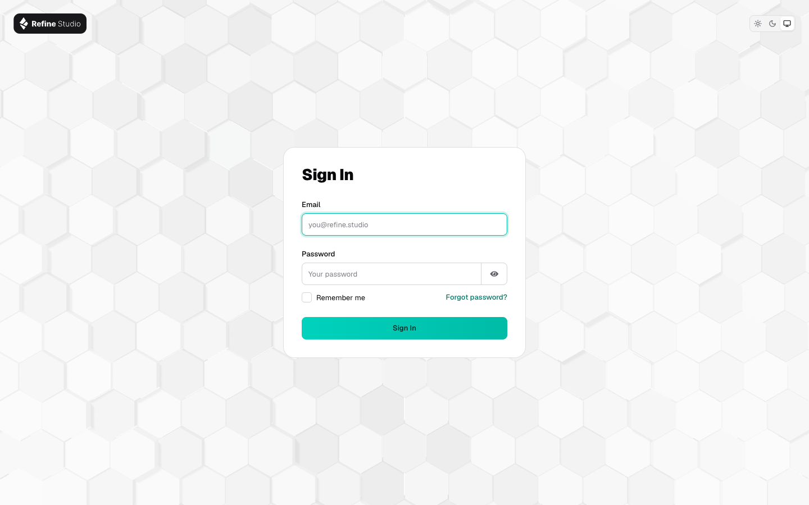
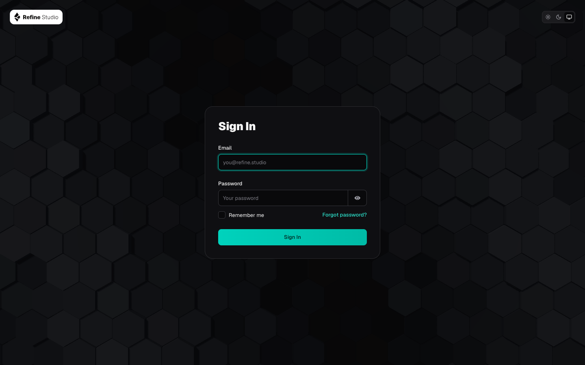
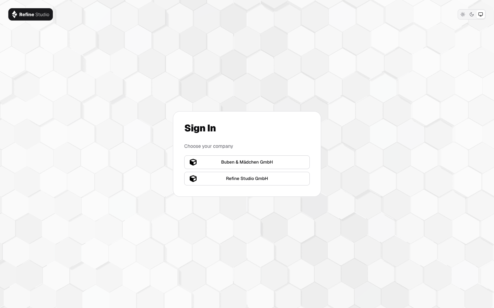
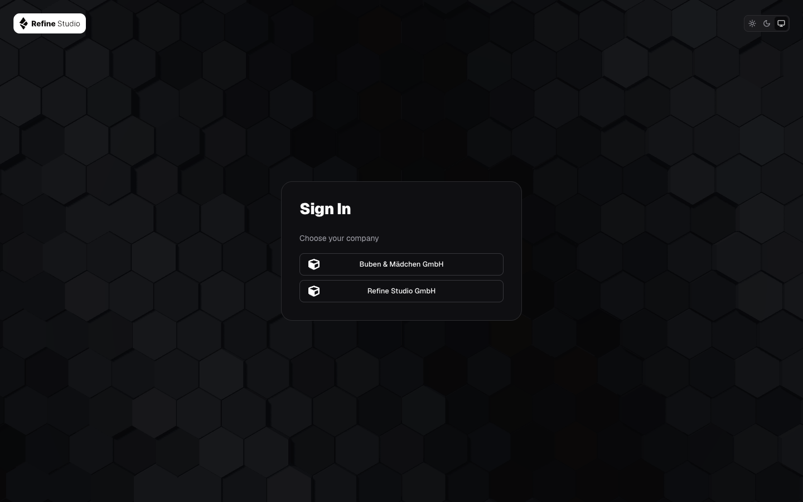
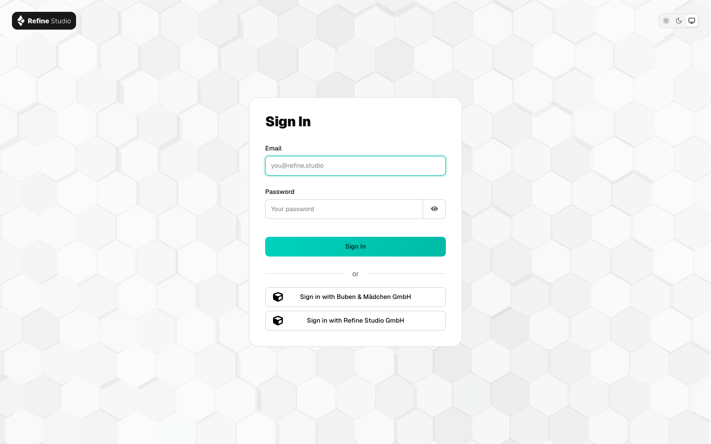
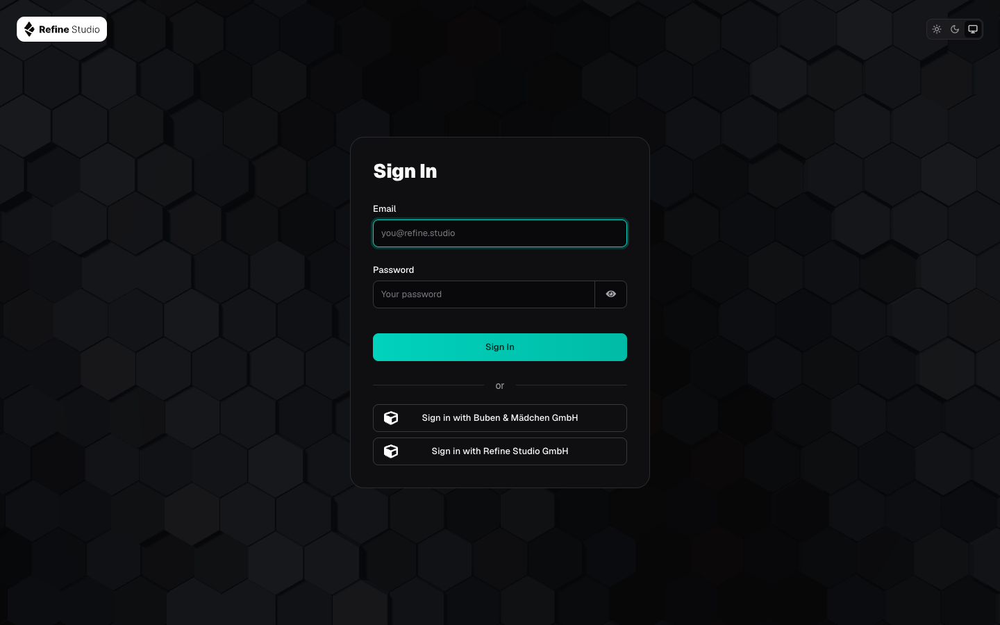

# 🔐 refine-keycloak

The refine-branded Keycloak **login** theme for `login.refine.studio`. It is a child theme of
`keycloak.v2`, follows the visitor's light or dark setting, and shows the rippling hexagon
background of refine.studio behind a form styled after refine-ui. It changes only the login pages. The account console and the
admin console keep the stock look.

| Light | Dark |
| ----- | ---- |
|  |  |

`docs/screenshots/` holds every screen in both modes: sign-in, password reset, one-time code
setup, one-time code entry, update password, and the error page.

## 🚀 Install on a server

Tested on Keycloak **26.8.1**. You need admin access to the server and to the realm.

**Before you start:** open the admin console, then the user menu → _Server info_. Check that
the version is 26.x. On another major version, stop here: the theme is tested on 26.x only.

1. Download `refine-keycloak-<version>.jar` from the latest GitHub release.
2. Copy the file to `/opt/keycloak/providers/` and restart Keycloak. If the server starts
   with `--optimized`, run `kc.sh build` before the restart, or rebuild the image with the
   file in `providers/`.
3. In each realm, open _Realm settings_ → _Themes_, set _Login theme_ from the table below,
   and click _Save_.

| Realm                                   | Login theme     | Shows                                       |
| --------------------------------------- | --------------- | ------------------------------------------- |
| refine (`login.refine.studio`)          | `refine`        | email and password, plus any company logins |
| BuM SSO, the broker                     | `refine-broker` | only the company buttons                    |
| Buben & Mädchen                         | leave as is     | the stock look, for now                     |

`refine-broker` hides the email and password form from view. It does not switch password
sign-in off: the realm's sign-in rules stay exactly as they are. Use it only on a realm where
every user signs in through a company login, with the default `browser` flow. A flow that asks
for the username first draws another page, which the theme does not hide.

Never set it on the `master` realm. The admin login stays on the stock theme, so a broken
theme can never lock an admin out.

## ↩️ Roll back

In the same realm, set _Realm settings_ → _Themes_ → _Login theme_ back to the value it had
before, and click _Save_. On BuM SSO that value is _Choose…_, the server default. The change
is live on the next page load, and no restart is needed. The JAR can stay in `providers/`
until the next maintenance window.

## 🧑‍💻 Develop

Needs Docker and `make`.

| Command     | Does                                                                                   |
| ----------- | -------------------------------------------------------------------------------------- |
| `make dev`  | starts Keycloak 26.8.1 on http://localhost:8080 with the theme mounted from `themes/` |
| `make seed` | creates the user `demo` / `demo`, who must set up OTP at the first login, and `bum` / `bum` in the realm `bum` |
| `make jar`  | builds `build/refine-keycloak-<version>.jar`                                          |
| `make check-idp` | proves the company sign-in buttons lead where the stock theme sends them |
| `make hex`  | rebuilds the hexagon bundle from `src/hex/` (needs Node)                               |
| `make logs` | follows the Keycloak log                                                               |
| `make down` | stops Keycloak                                                                         |

Open http://localhost:8080/realms/refine/account to see the login page. Theme caching is off,
so a browser reload shows each edit under `themes/refine/login/` and
`themes/refine-broker/login/`. The local admin is `admin` / `admin` and exists only on your
machine.

The page follows the visitor's system setting. The toggle top right lets them pick light or
dark instead, and `js/mode.js` saves that choice in their browser.

The wording lives in `themes/refine/login/messages/messages_en.properties`: the short titles,
"Email" as the only sign-in name, and the field placeholders. The theme overrides one Keycloak
template, `field.ftl`, copied from 26.8.1 and changed only to read those placeholders. Before a
major Keycloak upgrade, compare it with the new `keycloak.v2` version.

The brand values are copied, not imported. `themes/refine/login/resources/css/refine.css`
names each source and its version in its header.

## 🔘 Company sign-in buttons

A realm can offer sign-in through other companies' logins, called identity providers. BuM SSO
offers two: "Buben & Mädchen GmbH" and "Refine Studio GmbH". The theme changes how those
buttons look and nothing else. Keycloak builds each button from the realm's identity provider
settings. The theme keeps the stock template that draws them and only adds CSS.

`make dev` starts a local stand-in for BuM SSO in the realm `broker`, on `refine-broker`,
with two company logins in the realms `bum` and `refine`. Open
http://localhost:8080/realms/broker/account and sign in as `bum` / `bum` through the first
button. The second button reaches the realm `refine`, where `demo` / `demo` must set up a
one-time code first. The broker needs the default port 8080.

`make check-idp` loads the broker's login page under the stock `keycloak.v2` theme, under
`refine`, and under `refine-broker`. It fails when any button leads somewhere else, or when
a click misses that company's login. Run it after every change to the CSS or the templates.

With `refine-broker`, as on BuM SSO:

| Light | Dark |
| ----- | ---- |
|  |  |

With `refine`, as on a realm that offers both:

| Light | Dark |
| ----- | ---- |
|  |  |

## ⬡ Hexagon background

The scene is the one from the refine.studio website, ported from React Three Fiber to plain
three.js in `src/hex/`. The built bundle `themes/refine/login/resources/js/hex.js` is
committed, so `make jar` needs only `zip`. After you change `src/hex/`, run `make hex`. That
step needs Node, and it pins three.js 0.185.1, the website's version, and esbuild 0.28.2.

| Visitor's setting | What they see                                       |
| ----------------- | --------------------------------------------------- |
| default           | the hexagons ripple in a slow wave, at 30 % opacity |
| reduced motion    | one still frame, nothing moves                      |
| no WebGL          | the website's still hexagon image                   |

The bundle is 519 KiB, or 131 KiB with gzip. Keycloak itself sends it uncompressed, so turn
on gzip at the reverse proxy in front of it. Browsers cache the file after the first visit.

## 📦 Release

Push a tag such as `v1.0.0`. The `release` workflow builds `refine-keycloak-1.0.0.jar` and
attaches it to a GitHub release.

## ⚖️ License

The theme is licensed under the [Apache License 2.0](LICENSE). The refine logo is the one
exception: `logo.svg` and `logo-dark.svg` stay all rights reserved. If you reuse the theme,
replace both files with your own logo. [NOTICE](NOTICE) lists the exception and credits
Keycloak, three.js and the Geist font.
